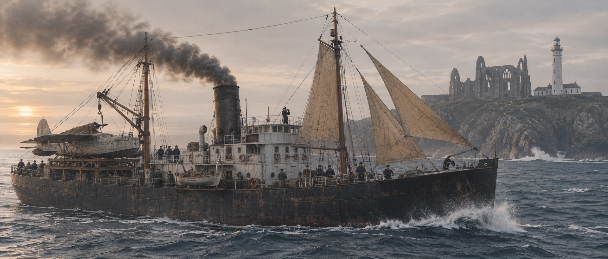

# 35 — Les navires de l'Îlot : moins de charbon, plus de vent (1945-1960)

> Comment l'îlot transforme ses chalutiers, ses cargos et ses barques pour dépendre moins du combustible, puis conçoit ses propres navires, dont un **navire de longue expédition** capable d'aller voir l'Europe de l'Atlantique et de la Manche.
>
> **[canon]** (décisions de l'auteur) : **un outil par usage** (option 1C) : cargos mixtes voile-vapeur, *paranze* à voile pour la pêche côtière, chalutiers à vapeur sobres pour le large, moteurs rustiques pour les barques ; **en deux temps** (option 2C) : des bricolages dès 1945, puis une conception raisonnée par le chantier naval vers 1956-1960 ; **dès les années 1940, l'îlot étudie un navire de longue expédition** (sur une base de chalutier ou de cargo), **portant un hydravion** mis à l'eau et repris à la grue, pour **aller au plus près de la catastrophe** et rendre compte de l'état de l'Europe (Lorient, Brest, la Manche, les bases anglaises). Il naît des **leçons de l'expédition de la Manche** de l'été 1942 ([36](36-expedition-de-la-manche.md) §8). **Pendant l'épidémie, un prototype est transformé à l'arsenal de Cagliari** à partir d'un **cargo désarmé de 1940** (B76, option A) : grue pour un hydravion de type Loire 130, infirmerie de bord, voile d'appoint si la machine tombe en panne, équipage réduit au minimum, radio à longue portée, **un groupe de fusiliers marins pour les expéditions à terre** ; **armé en 1949, essayé dans les eaux sardes, premier voyage vers la Manche en 1952-1954** (B75, option A) ; **son commandant est l'ancien enseigne du *Volta*** de 1942, entré au projet dès 1946 (option A). **[canon provisoire]** : les chiffres et le détail de ce chapitre.
>
> Ce chapitre complète [15](15-energie.md) §5 (la conversion au charbon) et [29](29-flotte-des-annees-1950.md) (la flotte active, le chantier naval).

## 1. Le problème : le charbon est aussi une dépendance [estimation]

Le chapitre [15](15-energie.md) a réglé la fin du mazout : tout ce qui navigue marche au **charbon du Sulcis**. Mais le charbon n'est pas gratuit :

| Ce que coûte le charbon | Ordre de grandeur [estimation 🔧] |
|---|---|
| **La mine** | Un mineur du Sulcis, à la main et au pic, tire de l'ordre de **150 à 250 t par an**. Les ~31 000 t de la flotte ([29](29-flotte-des-annees-1950.md) §3) occupent donc **150 à 200 mineurs**, au poste le plus dangereux de l'île ([15](15-energie.md) §4 bis) |
| **Les chauffeurs** | Un vapeur au charbon demande **deux à trois fois plus de chauffeurs et de soutiers** qu'au mazout : une dizaine pour un cargo de 3 000 tpl, contre trois ou quatre |
| **La qualité** | Le Sulcis chauffe **un tiers de moins** qu'un charbon gallois : soutes plus grandes, rayon d'action plus court, mâchefers et soufre qui rongent les chaudières ([15](15-energie.md) §5) |
| **Le transport** | Chaque tonne passe par la voie ferrée de Carbonia et par Portovesme avant d'arriver aux soutes |

**L'objectif** n'est donc pas de supprimer le charbon, mais de **brûler moins par tonne transportée et par poisson pêché**, et de **varier ce qu'on brûle**.

## 2. Les quatre leviers [histoire : techniques connues en 1940 ; estimation : gains]

### 2.1 Une vapeur plus sobre

| Mesure | Gain [estimation 🔧] | Précédent [histoire] |
|---|---|---|
| **Machine à triple expansion** à la place des vieilles machines compound des chalutiers, prise sur les cargos désarmés | 10 à 15 % | C'est la machine standard des cargos et des chalutiers des années 1920-1930 |
| **Turbine d'échappement Bauer-Wach** : une petite turbine récupère la vapeur à la sortie de la machine alternative et rend sa puissance sur l'arbre | ~20 % de puissance en plus pour le même charbon | Brevet allemand de 1926, très répandu dans les années 1930, notamment sur les chalutiers de la mer du Nord 🔎 |
| **Les briquettes de Carbonia** : charbon lavé du Sulcis aggloméré au brai de la distillerie de goudron ([15](15-energie.md) §6) | 5 à 10 %, et beaucoup moins de mâchefer | Les « agglomérés » des compagnies françaises et des chemins de fer |
| **Des hélices plus grandes et plus lentes**, l'allure économique (8 à 10 nœuds) | 10 à 20 % | La règle de [29](29-flotte-des-annees-1950.md) §5 : « à 12 nœuds, un navire dure ; à 25, il s'use » |
| **Des carènes propres** : une coque sale fait brûler **30 à 50 % de plus** | Le plus gros levier | Le carénage annuel de [29](29-flotte-des-annees-1950.md) §5 est aussi une économie de charbon |

**La turbine d'échappement** est le seul point délicat : elle demande des aubes et un réducteur. On en trouve peut-être sur des cargos désarmés ; sinon, l'atelier du ***Commandant Teste*** ([31](31-commandant-teste.md)) en refait une ou deux, sur le modèle des turbines auxiliaires des contre-torpilleurs démontés 🔧.

### 2.2 La voile auxiliaire : le vapeur mixte

- Un cargo a déjà des **mâts de charge**. On y établit des **voiles d'étai** et des **voiles auriques**, sans toucher à la coque. Sur les cargos qu'on refait, on monte un vrai gréement de **goélette**.
- **La machine sert dans les calmes, à l'entrée des ports et pour tenir l'horaire.** Sous voiles avec un bon vent de travers, on éteint une chaudière sur deux.
- **Le gain** : en Méditerranée, où le vent est irrégulier, **15 à 30 % de charbon en moins** sur une ligne longue comme celle de Gibraltar, avec ses mistrals et ses vents d'ouest ; beaucoup moins sur la navette de Malte [estimation 🔧].
- **Les marins existent** : les gens de mer de Carloforte et de Calasetta, les pêcheurs corses intégrés en 1940-1941 ([17](17-autosuffisance-alimentaire.md) §3.4), les Bretons des flottes françaises.

### 2.3 Le chalut sans machine : les *paranze*

- **Remorquer un chalut demande presque toute la puissance d'un navire.** Un chalutier seul ne peut pas chaluter à la voile, sauf avec un très petit filet.
- **La Méditerranée a sa solution** [histoire] : la **pêche en bœuf** (*pesca a coppia* des *paranze* de l'Adriatique, « bœufs » des tartanes de Provence et du Languedoc). **Deux voiliers** marchent de conserve et traînent un filet tendu entre eux. Pas une tonne de charbon.
- Les *paranze* travaillent **sur les fonds côtiers des golfes de Cagliari, d'Oristano et de Palmas** ; les chalutiers à vapeur gardent le large et les jours sans vent.

### 2.4 Des moteurs qui mangent n'importe quoi

| Moteur | Ce qu'il brûle | Pour qui | Précédent [histoire] |
|---|---|---|---|
| **Le semi-Diesel à boule chaude** : un moteur lent, à faible compression, allumé par une tête chauffée au chalumeau puis par sa propre combustion | Presque toute huile : **le brut d'Albanie décanté**, les huiles de goudron, l'**huile de poisson** des madragues, l'huile d'olive de rebut | Barques de pêche, vedettes, bacs de Carloforte et de La Maddalena, canots-moteurs | Les Bolinder suédois des bateaux de pêche ; en Italie, les tracteurs **Landini à *testa calda*** (depuis 1925) et Lanz Bulldog, présents dans les fermes de Sardaigne 🔎 |
| **Le gazogène marin** : un générateur de gaz pauvre alimente un moteur à explosion | Le **semi-coke** de la distillerie de Carbonia, sous-produit de la carbonisation à basse température ([15](15-energie.md) §6), ou le charbon de bois | Remorqueurs de port, vedettes, la chaloupe de travail | Les bateaux de pêche suédois et finlandais au gazogène pendant la guerre 🔎 ; les camions et le treuil d'Elmas de l'îlot ([20](20-capacites-aeronavales.md) §4.6) |

**Le semi-Diesel est la vraie trouvaille de l'îlot** : il n'a pas besoin de chauffeur, et il brûle le brut d'Albanie presque tel quel, sans passer par la distillerie. À partir de 1951, le brut de Kuçova rend l'idée possible ([34](34-avant-poste-d-albanie.md)). L'atelier du *Commandant Teste* sait remettre en état les moteurs trouvés ; vers 1955, l'arsenal de Cagliari sait en **couler** un monocylindre de 20 à 40 ch 🔧.

**Écartés** : le **rotor Flettner** (un cylindre tournant qui agit comme une voile, essayé en 1924-1926) est trop expérimental et demande un moteur électrique ; la **propulsion électrique** demande du plomb, réservé aux batteries du sous-marin ([29](29-flotte-des-annees-1950.md) §4.1).

## 3. Un outil par usage (option 1C) [canon : principe ; provisoire : détail]

| Usage | Navire | Propulsion | Ce qui change |
|---|---|---|---|
| **Les lignes des avant-postes** ([29](29-flotte-des-annees-1950.md) §4.5) | Les cargos ***Har Zion***, ***Jacques Schiaffino***, ***Anadyr*** | **Vapeur mixte** : voiles d'étai et voiles auriques sur les mâts de charge ; briquettes ; allure de 8 à 9 nœuds | 15 à 30 % de charbon en moins sur la ligne de Gibraltar ; la navette de Malte, courte, reste surtout à la vapeur |
| **La pêche côtière** | Les ***paranze*** : paires de voiliers de 12 à 18 m, gréés en latin ou en aurique, construits à Carloforte | **Voile seule** | Le chalut côtier sans charbon. Vers 1950, **une quinzaine de paires** [estimation] |
| **La pêche au large** | Les **petits vapeurs** de [29](29-flotte-des-annees-1950.md) §3 : chalutiers à vapeur, puis la série du chantier (§5) | **Vapeur sobre, gréé en ketch** : triple expansion, hélice lente, misaine et artimon pour tenir la cape et économiser en route | La machine ne sert qu'à chaluter et à rentrer |
| **Le cabotage, les bacs, les barques** | Barques de pêche, bacs de Carloforte et de La Maddalena, vedettes | **Semi-Diesel au brut d'Albanie** ou à l'huile de poisson ; voile latine en appoint | Plus de chauffeur à bord |
| **Le port** | Les deux remorqueurs, les vedettes | Vapeur pour les remorqueurs (il faut de la puissance) ; **gazogène au semi-coke** pour les vedettes | — |
| **La garde des côtes** | Les avisos, puis les chalutiers armés et les avisos neufs ([29](29-flotte-des-annees-1950.md) §6) | Vapeur ; **un mât de misaine gréé** sur les avisos neufs, pour la croisière lente | La patrouille se fait à 6-8 nœuds, la vitesse est gardée pour la poursuite |
| **Les expéditions lointaines** | **Le navire de longue expédition** (§6) | Vapeur mixte, gréement complet | Voir §6 |

**Le bilan visé vers 1960** [estimation 🔧] : à trafic égal, la flotte brûle **20 à 25 % de charbon en moins** qu'en 1950. Le charbon économisé (6 000 à 8 000 t par an) va aux ateliers, aux forges et à l'expansion vers le nord. Une **cinquantaine de chauffeurs** passent à la pêche et aux machines-outils.

## 4. Le calendrier en deux temps (option 2C) [canon : principe ; provisoire : détail]

### 4.1 Le temps du bricolage (1945 – 1950)

L'île est fermée (1944-1949, [14](14-epidemie.md) §5.6), le mazout s'épuise et sera gelé en 1948 ([15](15-energie.md) §3). Chaque bord fait avec ce qu'il a :
- **1945-1946** : les caboteurs et les barques sardes remettent leurs **voiles latines** ([11](11-ilot-de-civilisation.md) §3) ; les premières **paires de *paranze*** sortent des chantiers de barques de Carloforte, sur les conseils des pêcheurs corses et des marins de Provence.
- **1946-1948** : on grée des **voiles d'étai** sur les mâts de charge des cargos ; on tient pour chaque navire un **carnet de consommation** (charbon par mille, par vent et par état de mer), qui deviendra la base des calculs du bureau (§4.2).
- **1947** : premières **briquettes** de Carbonia, avec le brai de la distillerie de goudron.

### 4.2 Le Bureau des plans (1946)

**[canon provisoire]** En 1946, le Conseil crée un **Bureau des plans**, rattaché à l'arsenal de Cagliari et logé à bord du ***Commandant Teste*** ([31](31-commandant-teste.md)) :
- **Qui** : les quelques ingénieurs du **Génie maritime** français, du **Genio Navale** italien et les *constructors* de la Royal Navy présents en 1940 ([29](29-flotte-des-annees-1950.md) §6), avec des dessinateurs et des maîtres de l'arsenal.
- **Ce qu'il a** : les plans des navires de 1940 (à bord, dans les archives de chaque navire), les manuels des écoles, les **carnets de consommation** des bords. Ni bassin d'essais, ni moyens de calcul : des règles à calcul, des tables, des **maquettes** essayées dans le bassin du port.
- **Ses trois travaux** : (1) les **gréements des cargos** et des chalutiers ; (2) le **plan type d'un chalutier mixte** pour la série des années 1950 ; (3) **l'étude du navire de longue expédition** (§6), demandée par le Conseil dès 1946-1947.
- **C'est le travail des années fermées** : on ne peut pas sortir, mais on peut dessiner. Le Bureau devient en 1956 le service d'études du chantier naval (§5) et le lieu de stage de l'option de construction navale ([30](30-formation-technique.md) §6).

### 4.3 Le temps de la conception (1950 – 1960)

- **1951-1953** : les premiers **semi-Diesel** tournent au brut d'Albanie sur les bacs et les barques.
- **1952-1955** : une **turbine d'échappement** est montée sur l'***Anadyr***, le cargo de la ligne la plus longue 🔧.
- **1956-1960** : le **chantier naval de l'Îlot** (§5) construit une première série de **chalutiers mixtes** sur le plan du Bureau, puis les **avisos neufs** ([29](29-flotte-des-annees-1950.md) §6).

## 5. Le chantier naval [renvoi]

Le chantier est décrit au chapitre [29](29-flotte-des-annees-1950.md) §6 : cale de construction près de l'arsenal de Cagliari [lieu à décider, B57], acier de l'*Ark Royal* (1957-1963), ouvriers de l'École technique et charpentiers de Carloforte. Ce chapitre y ajoute deux choses :
- **un chantier de bois à Carloforte**, pour les *paranze* et les barques, qui existe dès 1945 (§4.1) ;
- **la série des chalutiers mixtes** (vers 1956-1960) : coque rivetée d'environ 35 m, machine à triple expansion de 300 à 400 ch, gréement de ketch, une dizaine de nœuds à la vapeur [estimation, à décider : nombre et noms]. C'est le **premier navire d'acier construit dans l'île**, avant les avisos neufs : le chantier apprend sur un navire simple.

## 6. Le navire de longue expédition [canon : principe, coque (B76 A), calendrier (B75 A), commandant ; à décider : itinéraire, noms]

### 6.1 Pourquoi aller voir

**Décision de l'auteur** : l'îlot veut **avoir des nouvelles du plus près de la catastrophe** et **rendre compte de l'état de l'Europe** : la Bretagne (Lorient, Brest), la Manche, les bases anglaises.

**Le précédent de 1942** : l'îlot y est déjà allé une fois, en urgence, avec trois navires à mazout et un hydravion : l'**expédition de la Manche** ([36](36-expedition-de-la-manche.md)). Elle a montré ce qu'on peut voir en trois semaines, et tout ce qu'on n'a pas pu voir. Le navire de longue expédition est fait pour **y retourner**, et y rester.

**La radio ne suffit pas** ([16](16-contacts-radio.md)) :
- l'Écosse (la Clyde, Scapa Flow) n'est joignable que **par intermittence** ; la Bretagne, la Manche et le sud de l'Angleterre **ne répondent pas** ;
- **une voix dit qu'on vit, pas comment** : ni l'état des ports, ni celui des terres, ni ce que sont devenus les arsenaux ;
- **le creux radio** de 1953-1955 (minimum solaire, [16](16-contacts-radio.md) §5) fait taire les voix lointaines au moment même où l'îlot rouvert peut sortir.

**Les raisons du Conseil** [canon provisoire] :
- **La continuité française et britannique** : les marins de Gensoul et de Somerville veulent savoir ce qu'il reste de leurs pays. Brest est le port de l'École navale, Plymouth et Portsmouth ceux de la Royal Navy.
- **La science** : le Conseil scientifique ([19](19-savoir-et-medecine.md) §3.5) veut mesurer ce que la comète a laissé (éjectas, sols, forêts, état des villes) au plus près du cratère de Rambouillet.
- **Le charbon gallois** : s'il reste des poches autour des mines du pays de Galles ([07](07-le-monde-apres.md) §1), c'est le meilleur charbon de chauffe du monde.
- **Les arsenaux** : outillage, plans, pièces, livres, peut-être des navires.

### 6.2 Ce qu'on trouvera [estimation]

*D'après le chapitre [02](02-impact-rambouillet.md).*

| Lieu | Distance du cratère [calcul] | En 1940 [histoire] | État probable |
|---|---|---|---|
| **Le Havre** | ~155 km | Port de commerce, occupé par les Allemands depuis le 13 juin 1940 | Ville détruite par le souffle et le feu ; quelques dizaines de centimètres d'éjectas ; **le port le plus proche du cratère** |
| **Cherbourg** | ~270 km | Arsenal, occupé depuis le 19 juin 1940 | Maisons détruites |
| **Portsmouth** | ~320 km | Grand arsenal de la Royal Navy | Arsenal ravagé, navires endommagés, incendies ([02](02-impact-rambouillet.md) §3) |
| **Lorient** | ~390 km | Arsenal, occupé le 21 juin 1940 ; la Kriegsmarine y prépare une base de sous-marins | Toitures arrachées, incendies |
| **Brest** | ~460 km | Arsenal et École navale, occupés le 19 juin 1940 | À la limite des toitures arrachées : **le port le mieux conservé** de la côte |
| **Plymouth** (Devonport) | ~470 km | Grand arsenal de la Royal Navy | Comme Brest |

**Les dangers** : les **champs de mines** posés en 1939-1940 dans la Manche et devant les ports (les orins rouillent, les mines dérivent 🔎) ; les épaves dans les passes ; les tempêtes de l'Atlantique ; les pillards ; **la peste** (quarantaine à l'Asinara au retour, [18](18-expedition-albanie.md) §7.3).

### 6.3 Le programme du navire [canon provisoire]

| Exigence | Réponse |
|---|---|
| **Le rayon d'action** : Cagliari – Gibraltar – Brest – la Manche – retour, **environ 5 000 milles**, avec escale de charbon à Gibraltar | ~25 jours de vapeur à 9 nœuds ; **600 à 800 t de charbon** en soute, moins avec la voile |
| **La tenue à la mer** de l'Atlantique et de la Manche | Une coque haute, faite pour le mauvais temps |
| **L'économie et la sécurité** | **Vapeur**, avec une **voile d'appoint** (décision de l'auteur) : de quoi tenir la cape, gouverner et rallier une côte **si la machine tombe en panne**, et soulager la chaudière par vent portant. Pas de gréement complet : il demanderait trop de gabiers (§6.3 bis) |
| **L'hydravion** | Un **Loire 130** ([20](20-capacites-aeronavales.md)) : environ 3,5 t en charge, 16 m d'envergure, **conçu pour être catapulté et repris à la grue** par les croiseurs [histoire 🔎]. Le navire porte une **bigue ou une grue de 5 t** et un ber sur le pont ; le Loire 130 est mis à l'eau à la grue et décolle de la mer calme, puis il est repris de la même façon |
| **Pourquoi un hydravion** | Voir **à l'intérieur des terres** sans débarquer : depuis l'estuaire de la Seine, le cratère de Rambouillet est à **~160 km**, soit un aller-retour d'environ trois heures de vol. Repérer les passes, les épaves, les fumées des survivants |
| **Le carburant d'aviation** | Le **benzol de Carbonia** et les fractions légères du brut d'Albanie ([20](20-capacites-aeronavales.md) §3) : **3 à 5 t** pour une expédition, en fûts dans une soute isolée |
| **L'équipage** | **Réduit au minimum** (décision de l'auteur), pour donner la place au charbon, à l'hydravion et aux passagers : **une quarantaine de marins** et **une douzaine de passagers de mission** (équipe de l'hydravion, médecin, savants, photographe) ; **un groupe de fusiliers marins** (décision de l'auteur) pour les expéditions à terre (§6.3 bis) |
| **L'infirmerie** | **Une infirmerie de bord** (décision de l'auteur) : salle de soins, quelques lits et **une chambre d'isolement**, la leçon de la Morìa ; elle reçoit aussi les survivants recueillis (§6.3 bis) |
| **La radio** | **Une station à longue portée** (décision de l'auteur) : de quoi tenir la vacation avec Cagliari depuis la Manche et l'Écosse, et parler avec Brest (§6.3 bis) |
| **Le reste** | Un **laboratoire** ; une **vedette à semi-Diesel** pour les reconnaissances de port ; des **scaphandriers** ; une soute à vivres pour quatre mois |

### 6.3 bis Le prototype de Cagliari (1946 – 1952) [canon : principe, coque, calendrier, commandant ; provisoire : détail]

**Décision de l'auteur** : le navire de longue expédition n'attend pas le chantier naval des années 1950. **Pendant l'épidémie**, l'arsenal de Cagliari transforme un navire existant en **prototype**. Le cahier des charges est celui de l'auteur : **une grue pour hisser un hydravion de type Loire 130, une infirmerie de bord, une voile d'appoint si la machine tombe en panne, un équipage minimal pour gagner de la place, une radio à longue portée, et la place pour quelques fusiliers marins pour les expéditions à terre.**

**Pourquoi pendant l'épidémie** [canon provisoire] :
- **L'île est fermée** (1944-1949, [14](14-epidemie.md) §5.5) : les cargos ne sortent presque plus, plusieurs sont désarmés, et les ouvriers de l'arsenal ont du temps. On ne peut pas aller voir l'Europe, mais on peut **préparer le navire qui ira**.
- **Le Bureau des plans** (§4.2) a déjà les leçons de 1942 ([36](36-expedition-de-la-manche.md) §8) et les carnets de consommation des bords. Le prototype est son premier grand travail.
- **Le Conseil veut être prêt à la réouverture** : la règle de Marseille fixe la date, à deux ans près ([14](14-epidemie.md) §5.6).

**La coque : un cargo désarmé de 1940** (option B76 A) [navire réel à choisir parmi les cargos retenus en 1940 🔎] : un vapeur d'environ **2 500 tpl**, long d'environ **80 m**, avec une machine à triple expansion de 1 000 à 1 500 ch, des chaudières cylindriques **au charbon** et deux mâts de charge. Un chalutier aurait été plus marin et plus sobre en hommes, mais trop petit pour porter à la fois 700 t de charbon et un hydravion de 16 m d'envergure.

**Les transformations** [canon provisoire ; chiffres : estimation 🔧] :

| Partie | Avant (cargo) | Après (prototype) |
|---|---|---|
| **Cales avant** | Marchandises | **Soutes de charbon supplémentaires** : 700 t en tout. À 9 nœuds, la machine brûle **environ 23 t par jour** de charbon du Sulcis ; le voyage Cagliari – Manche – Cagliari (environ 4 500 milles) en demande ~420 t, et deux mois sur place ~135 t (§6.3 ter) |
| **Cale arrière et mât arrière** | Mât de charge de 3 à 5 t | **Grue de 5 t** : mât arrière renforcé, bigue lourde, treuil à vapeur. **Ber de l'hydravion** sur le panneau renforcé de la cale arrière ; le Loire 130 y repose **ailes repliées** [🔎 repliage des ailes du Loire 130], sous une bâche. En dessous, la **soute d'essence isolée** (3 à 5 t en fûts, §6.3) et l'atelier d'aviation |
| **Faux-pont** | Entrepont de marchandises | **L'infirmerie** : salle de soins et de petite chirurgie, **six lits**, **une chambre d'isolement de deux lits**, une **étuve à désinfection** pour l'épouillage (la leçon du typhus craint en 1942, [36](36-expedition-de-la-manche.md) §7) ; le **laboratoire** ; les **cabines des passagers de mission** ; le **poste des fusiliers marins** et une **soute à armes** fermée à clé ; un poste pour **20 à 30 survivants** recueillis |
| **Passerelle** | Poste radio de cargo, de faible portée | **Station radio à longue portée** : un émetteur à ondes courtes pris sur un croiseur désarmé ([29](29-flotte-des-annees-1950.md) §7, les donneurs de pièces), des récepteurs de trafic, une antenne tendue entre les deux mâts, **un jeu de lampes d'émission de rechange** réservé au navire ([16](16-contacts-radio.md) §7, l'atelier des lampes). Portée visée : la vacation avec Cagliari depuis la Manche et l'Écosse, de jour ou de nuit selon la bande |
| **Gréement** | — | **Voile d'appoint** : une misaine et une grand-voile auriques sur les deux mâts, une trinquette et un foc ; environ 400 m². Par vent frais portant, **2 à 4 nœuds sans machine** : assez pour gouverner, tenir la cape et rallier une côte si la machine tombe en panne ; en route, elle soulage la chaudière |
| **Machine** | Chauffe à la main, équipe de cargo | Mêmes chaudières, **remises à neuf** ; grilles et tirage revus pour les briquettes de Carbonia (§4.1) ; une **turbine d'échappement** est envisagée plus tard (§4.3) |

**L'équipage minimal** [canon : principe ; provisoire : chiffres] :

| Service | Effectif | Détail |
|---|---|---|
| **Commandement et pont** | ~15 | Le commandant, le second, deux officiers de quart, un maître d'équipage, neuf matelots (trois par quart, qui manœuvrent aussi la grue et la voile), un charpentier-voilier |
| **Machine** | ~13 | Un chef mécanicien, trois mécaniciens, neuf chauffeurs et soutiers (trois par quart) |
| **Radio** | 3 | Un par quart : la vacation ne s'arrête jamais |
| **Service et santé** | ~5 | Cuisinier, boulanger, aide, maître d'hôtel ; un **infirmier** |
| **Équipage** | **~36 à 40** | Un cargo de cette taille en avait 25 à 35 en 1940 : on n'ajoute que le quart de radio, les matelots de la grue et l'infirmier |
| **Passagers de mission** | **~12** | Un pilote, un observateur et deux mécaniciens d'aviation ; le **médecin** de l'expédition ; quatre ou cinq savants (géologue, météorologue, biologiste, ingénieur) ; un photographe ; un interprète |
| **Fusiliers marins** | **~10** | Un **groupe** du corps du Pont ([22](22-organisation-militaire.md) §5) : un second-maître fusilier et neuf fusiliers, avec fusils, deux fusils-mitrailleurs et un poste radio portatif |
| **À bord en tout** | **~60** | Logés au faux-pont, à la place des marchandises |

**Les fusiliers marins** (décision de l'auteur) [provisoire : effectif et détail] :
- **À terre**, ils forment le noyau de chaque descente : ils **escortent les savants** et le médecin, gardent la vedette et le point de débarquement, et **accompagnent les reconnaissances à l'intérieur**, à quelques jours de marche du navire. La leçon de 1942 : à Brest, l'enseigne du *Volta* était parti à l'intérieur avec quelques marins et un guide ([36](36-expedition-de-la-manche.md) §6.2), sans troupe faite pour cela.
- **À bord**, ils montent la garde au mouillage et à la coupée (pillards, inconnus, quarantaine des survivants recueillis) et, pour ne pas peser sur l'équipage minimal, ils **renforcent les matelots** à la grue de l'hydravion et à la voile.
- **Un groupe, pas une section** : le prototype n'est pas fait pour combattre. S'il faut plus de monde à terre, une **corvée de marins armés** les rejoint, au prix des quarts du bord.

**Le calendrier** (option B75 A) [canon : armement en 1949, premier voyage en 1952-1954 ; provisoire : détail] :

| Date | Étape |
|---|---|
| **1946** | Le Bureau des plans reçoit la commande du Conseil. **L'ancien enseigne du *Volta*** y est détaché comme témoin de 1942 |
| **1947** | Choix de la coque parmi les cargos désarmés ; plans de transformation, essais de maquettes dans le bassin du port |
| **1947 – 1949** | **Transformation à l'arsenal de Cagliari**, en même temps que la conversion du *Georges Leygues* au charbon ([15](15-energie.md) §5) : soutes, grue, infirmerie, radio, gréement |
| **1949** | **Armement du prototype.** Premiers essais à la mer dans le golfe de Cagliari, à l'intérieur des eaux gardées de l'île fermée |
| **1949 – 1951** | **Essais** : tour de la Sardaigne, essais à la voile seule machine stoppée, essais de grue avec une **charge lestée de 3,5 t** (la masse d'un Loire 130 en charge), vacations radio à grande distance avec Gibraltar et Malte ; un voyage de doublure sur la ligne de Gibraltar ([29](29-flotte-des-annees-1950.md) §4.5) |
| **1951** | **Premier hissage d'un vrai Loire 130** dans le golfe de Cagliari, avec **Tom Penhallow**, quelques semaines après le premier vol de la Flottille ([20](20-capacites-aeronavales.md) §4.3) |
| **1952** | Navigation sous patente de santé ([14](14-epidemie.md) §5.6) : **le prototype est déclaré bon pour la longue expédition.** L'ancien enseigne en prend le commandement |
| **1952 – 1954** | **Premier voyage vers la Bretagne et la Manche** [année exacte et itinéraire à décider, B75 et B77] |

**Le commandant : l'ancien enseigne du *Volta*** (option A) : **Jean de Kerangal** [personnage inventé, protagoniste du futur roman, B88] :
- **1942** : **enseigne de vaisseau** sur le *Volta* ; il part à terre chercher sa famille à l'intérieur de la Bretagne ([36](36-expedition-de-la-manche.md) §6.2).
- **1946** : lieutenant de vaisseau. Il est **détaché au Bureau des plans** comme officier du programme : il est l'un des rares officiers de l'îlot à avoir vu la Bretagne et la Manche après la catastrophe, et il sait ce qui a manqué en 1942 (le temps sur place, l'hydravion, la place à bord).
- **1947 – 1949** : **officier d'armement**. Il suit la transformation à l'arsenal, choisit l'équipage et défend devant le Bureau l'infirmerie et la radio.
- **1949 – 1952** : **second** pendant les essais, sous son ancien commandant du *Volta*, **Charles Jacquinet** ([36](36-expedition-de-la-manche.md) §3.3) [canon : décision de l'auteur, B116].
- **1952** : **commandant** du navire, vers 33 ou 34 ans. Jacquinet, malade, lui passe le commandement au printemps et débarque ; il meurt à Cagliari quelques mois plus tard, pendant le premier voyage [canon : B116, option A]. Il le conduit au premier voyage vers la Bretagne, **dix ans après l'expédition de la Manche.**

*Printemps 1953 [année à décider, B75], premier voyage : le prototype de longue expédition arrive devant la pointe Saint-Mathieu, à l'entrée du goulet de Brest, dix ans après l'expédition de la Manche. Fumée noire du charbon du Sulcis, voile d'appoint établie, Loire 130 bâché sur son ber sous la grue arrière, vedette dans ses bossoirs ; sur le toit de la passerelle, un officier observe la côte à la jumelle. Sur la falaise, les ruines de l'abbaye Saint-Mathieu et le phare [histoire : l'abbaye est en ruine depuis la Révolution, le phare est bâti dans son enclos].*

**Écarts de l'image au canon et à l'histoire** :
- **Le gréement** : seul le mât avant porte de la toile, et ce sont des voiles triangulaires (une sorte de voile au tiers et deux focs) ; le canon prévoit une **misaine et une grand-voile auriques sur les deux mâts**, plus une trinquette et un foc (§6.3 bis). Le mât arrière, qui porte la grue, est nu.
- **Le vent ne tient pas** : la fumée file vers l'arrière, donc le vent apparent vient de l'avant, alors que les voiles sont gonflées comme par un vent arrière.
- **La lumière** : c'est un **soleil couchant** sur la mer, à l'ouest, et non l'aube demandée par le prompt. Elle reste cohérente avec un navire venu d'Ouessant, qui fait route à l'est vers le goulet en fin de journée.
- **Le Loire 130** : l'aile semble déployée, et non repliée le long de la coque, et le moteur au-dessus de l'aile disparaît sous la bâche ; l'appareil est bien un **monoplan à coque** à dérive unique, conforme pour l'essentiel.
- **La coque** paraît plus courte que les ~80 m prévus, et **trop rouillée** pour un navire armé en 1949 et entretenu par l'arsenal ; la rouille dit plutôt les années fermées.
- **L'équipage** : une trentaine d'hommes alignés sur le pont, comme pour une revue ; on ne distingue pas les **fusiliers marins** et leurs armes.
- **Le phare de Saint-Mathieu** a en réalité le **haut de la tour peint en rouge** [histoire 🔎], et la pointe est une falaise d'une vingtaine de mètres, plus basse que sur l'image.
- **Conformes au canon** : la cheminée unique et la fumée de charbon, la grue sur le mât arrière, le ber de l'hydravion sur la cale arrière, l'antenne radio tendue entre les mâts, la vedette, **aucun pavillon** (le pavillon de l'Îlot n'est pas encore dessiné, B34) et **aucun radar**.

### 6.3 ter L'autonomie du prototype [estimation 🔧 ; calcul : `calculs/autonomie_prototype.py`]

**La question de l'auteur** : combien de charbon embarquer, quelle réserve d'électricité, et combien de temps le navire tient-il loin de tout ? Le calcul ci-dessous donne des ordres de grandeur ; toutes les hypothèses sont dans le script.

**Les hypothèses** :
- **La coque** : déplacement en charge d'environ 3 800 t ; puissance donnée par le **coefficient de l'Amirauté** (≈ 200 pour un cargo de 1940), qui fait varier la puissance comme le **cube de la vitesse**.
- **Le charbon** : celui du **Sulcis** (~5 000 kcal/kg, [15](15-energie.md) §5), dont il faut **1,5 fois plus** que de bon charbon gallois : environ **1,05 kg par cheval et par heure** pour une machine à triple expansion, au lieu de 0,7. **Gibraltar n'a pas de charbon à lui** : son dépôt est fait de charbon sarde apporté par l'*Anadyr* ([07](07-le-monde-apres.md) §2 bis). On compte 1 t par jour pour les auxiliaires en route.
- **La voile d'appoint** : une économie **prudente de 10 %** sur les traversées océaniques, aucune dans la Manche.
- **Au mouillage** : 3 t par jour avec une chaudière sous pression (dynamo, cuisine, évaporateur, grue), 1,5 t en veille ; moitié-moitié sur un séjour.
- **La réserve** : on ne compte jamais sur les **15 derniers %** de la soute.

**1. La machine** :

| Vitesse | Puissance | Charbon par jour | Charbon par mille (avec la voile) | Rayon d'action avec 700 t (réserve gardée) |
|---|---|---|---|---|
| 7 nœuds | ~420 ch | ~11,5 t | ~62 kg | ~9 600 milles |
| 8 nœuds | ~620 ch | ~16,7 t | ~78 kg | ~7 600 milles |
| **9 nœuds** (route) | ~890 ch | **~23 t** | ~97 kg | **~6 100 milles** |
| 10 nœuds | ~1 220 ch | ~32 t | ~119 kg | ~5 000 milles |

Chaque nœud au-dessus de 8 coûte cher : à 7 nœuds, le navire va **deux fois plus loin** qu'à 10 avec le même charbon. Le prototype fait route à **9 nœuds** sur l'océan et à **8** dans la Manche (mines, épaves, passes).

**2. Le voyage type** : Cagliari – Gibraltar – Lorient – Brest – Plymouth – Portsmouth – baie de Seine – Ouessant – Gibraltar – Cagliari, environ **4 500 milles** avec les allées et venues, et **60 jours sur place**.

| Cas | Soute au départ | Escales de charbon | Durée | Point bas de la soute | Verdict |
|---|---|---|---|---|---|
| A | 700 t | Gibraltar, à l'aller et au retour | ~85 jours | ~300 t (43 %) | Large marge |
| A bis | 700 t | Aucune | ~81 jours | ~145 t (21 %) | Possible, juste au-dessus de la réserve |
| B | 1 000 t (cale 2 en soute de réserve) | Gibraltar | ~85 jours | ~600 t (60 %) | Très large |
| E | 700 t | Gibraltar ; **extension vers Milford Haven et la Clyde** (+1 150 milles, B77) | ~90 jours | ~190 t (27 %) | Possible |
| D | 1 000 t | Gibraltar ; extension vers la Clyde | ~90 jours | ~490 t (49 %) | Large marge |

**Ce que le calcul apprend** :
- **Le voyage brûle environ 420 t de route et 135 t de séjour.** Avec 700 t et un plein à Gibraltar, le prototype peut rester **près de cinq mois** sur place (~145 jours) avant d'entamer sa réserve.
- **Le charbon n'est donc pas la limite : ce sont les vivres, l'eau et les hommes.** Les vivres sont prévus pour 120 jours ; l'équipage, lui, se fatigue.
- **Gibraltar est une sécurité, pas une nécessité** : sans lui (cas A bis), le voyage passe encore, mais sans marge pour une tempête, une panne ou un détour.
- **La cale 2 peut rester libre** pour le grain des échanges, les recueillis, les plans et les livres, ou recevoir 300 t de charbon de réserve si l'on va jusqu'à la Clyde.

**3. L'électricité et les batteries** :
- **Le réseau** : 110 V continu, comme sur les navires de 1940, fourni par **deux dynamos à vapeur de 25 kW** (dont une de secours). La station radio principale (~1 kW à l'antenne, ~3 kW absorbés) ne tourne que sur dynamo.
- **Le pire cas** : **chaudières éteintes** (avarie, manque d'eau, ou navire à la voile seule). Alors tout repose sur la **batterie d'accumulateurs** :

| Charge de secours | Énergie par jour |
|---|---|
| Émetteur de secours (~150 W à l'antenne, une heure de vacation) | 0,4 kWh |
| Récepteur de trafic (12 h d'écoute) | 0,5 kWh |
| Éclairage de secours (300 W, 6 h) | 1,8 kWh |
| Infirmerie (100 W, 8 h) | 0,8 kWh |
| Sondeur et divers | 0,3 kWh |
| **Total** | **~3,8 kWh par jour** |

- **La batterie** : pour **dix jours sans vapeur**, sans jamais descendre sous la moitié de la charge, il faut **~76 kWh** : **55 éléments au plomb de 2 V et d'environ 700 Ah**, soit **~3 t** (≈ 55 kg par élément), logés dans un local ventilé au faux-pont, bas dans la coque, où ils servent aussi de lest. Les feux de route sont doublés de **fanaux à pétrole**.
- **D'où vient la batterie** : de l'**atelier des accumulateurs** monté pour le sous-marin *Alagi* (plomb de l'Iglesiente, acide des chambres de plomb, séparateurs en bois, [29](29-flotte-des-annees-1950.md) §4.1). Le prototype est son **deuxième client**, avec une batterie vingt fois plus petite que celle d'un sous-marin.
- **La recharge** : sur la dynamo, à environ 70 A (~8 kW) pendant une douzaine d'heures. **Après 1951**, un **groupe de secours semi-Diesel de 5 kW** au brut d'Albanie (§2.4) recharge la batterie sans vapeur, pour une quarantaine de kilos de brut.

**4. L'eau, les vivres, l'essence** :

| Poste | Besoin | Réserve | Autonomie |
|---|---|---|---|
| **Eau de boisson** | 10 L par personne et par jour : 0,6 t/j pour 60, 0,9 t/j avec 30 recueillis | 50 t (caisses du double fond) | **~80 jours** sans évaporateur (~55 avec les recueillis) |
| **Eau des chaudières** | ~1,4 t/j en route (1 % de la vapeur perdue) | ~100 t d'eau d'alimentation | Refaite par l'**évaporateur** (dans les 1 t/j des auxiliaires) |
| **Vivres** | ~1,3 kg par personne et par jour | **~12 t** (120 jours pour 60, plus 60 jours pour 30 recueillis) | 120 jours, plus la pêche |
| **Essence d'aviation** | ~130 kg par heure de vol du Loire 130 ([36](36-expedition-de-la-manche.md) §3.2) | 4 t en fûts | **~26 h de vol**, soit 8 ou 9 vols de trois heures, pertes comprises |

**5. Les masses** : avec 700 t de charbon, l'eau, les vivres, l'hydravion, la vedette et le matériel, le navire n'embarque que **~900 t** sur ses 2 500 t de port en lourd. Il lui reste **~1 600 t** : le grain pour Brest, les recueillis, les plans et les livres au retour, et **du lest** (eau de mer, pierres), car un cargo trop léger roule fort et découvre son hélice. Le poids n'est jamais la limite ; **la place et les hommes** le sont.

### 6.4 Ce qu'il reste à décider

- ✅ **La coque** : un **cargo désarmé de 1940** (B76, option A). 🔎 Reste à choisir **le navire réel** parmi les cargos retenus à l'îlot en 1940.
- ✅ **Le calendrier** : transformation pendant l'épidémie, armement en 1949, premier voyage en 1952-1954 (B75, option A). ❓ Reste l'**année exacte** du premier voyage (1953 ? 1954, pendant le creux radio ?).
- **L'itinéraire** : la Bretagne et la Manche seulement, ou jusqu'à la Clyde et Scapa Flow ? (B77)
- **Le nom** du navire, et celui du chef de l'expédition s'il n'est pas le commandant (B78). ❓ Le commandant des essais (1949-1952).
- **L'autonomie** (§6.3 ter) : la soute (700 t, ou 700 t et la cale 2 convertible en soute de 300 t), la durée du séjour sur place, et l'autonomie de la batterie (dix jours sans vapeur proposés). (B91)

### 6.5 Ce qu'on ira chercher : les savants de l'Angleterre [canon : option B89 C ; provisoire : détail]

**Décision de l'auteur** : dans les années 1950, le navire de longue expédition va chercher en Angleterre, au pays de Galles et en Écosse **des ingénieurs et des savants** à ramener à Cagliari.
- **Les survivants de Devonport**, partis pour le pays de Galles en mai 1942 ([36](36-expedition-de-la-manche.md) §6.3), et avec eux **Stanley Kemp**, le directeur du laboratoire de Plymouth, mort vers 1947 au pays de Galles : on ne rapporte que ses carnets ([38](38-personnages-historiques.md) §6).
- **La Clyde** : les chantiers de construction navale (John Brown à Clydebank, Fairfield à Govan) et la chaire d'architecture navale de l'université de Glasgow [histoire] étaient en 1940 le cœur de la construction navale britannique. **Des architectes navals et des ingénieurs de la Clyde** arrivent juste à temps pour le **chantier naval de l'Îlot** (1956-1960, [29](29-flotte-des-annees-1950.md) §6).
- **Ce qu'on offre** : le grain, le passage, la règle des diplômes ([19](19-savoir-et-medecine.md) §3.7), et la perspective de bâtir des navires.
- **Les noms** : à chercher parmi les hommes réels de 1940 (règle des noms), une fois l'itinéraire fixé (B77) 🔎.

## 7. Chronologie [canon provisoire, sauf mention]

| Date | Événement |
|---|---|
| **1945 – 1946** | Retour des voiles latines sur les caboteurs ; premières **paires de *paranze*** à Carloforte |
| **1946** | Création du **Bureau des plans**, à bord du *Commandant Teste* |
| **Été 1942** | **Expédition de la Manche** ([36](36-expedition-de-la-manche.md)), dont les leçons fondent le navire de longue expédition |
| **1946 – 1947** | Le Conseil demande l'étude d'un **navire de longue expédition** [canon : conception dès les années 1940] |
| **1946 – 1948** | Voiles d'étai sur les cargos ; carnets de consommation |
| **1947** | Premières briquettes de Carbonia |
| **1951 – 1953** | Premiers semi-Diesel au brut d'Albanie sur les bacs et les barques |
| **1952 – 1955** | Turbine d'échappement sur l'*Anadyr* 🔧 |
| **1947 – 1949** | **Transformation du prototype de longue expédition** à l'arsenal de Cagliari, sur un cargo désarmé de 1940 (§6.3 bis) [canon : pendant l'épidémie] |
| **1949** | **Armement du prototype** ; essais dans les eaux sardes jusqu'en 1951 [canon] |
| **1951** | Premier hissage d'un Loire 130 à la grue du prototype |
| **1952** | L'ancien enseigne du *Volta* prend le commandement du prototype [canon : le commandant ; provisoire : l'année] |
| **1952 – 1954** | **Premier voyage vers la Bretagne et la Manche** [canon ; année exacte à décider] |
| **1956 – 1960** | Chantier naval de l'Îlot ; série des **chalutiers mixtes**, premier navire d'acier construit dans l'île |
| **Vers 1960** | La flotte brûle 20 à 25 % de charbon en moins qu'en 1950 |

## 8. Questions ouvertes

1. ✅ **La philosophie** : un outil par usage (option 1C).
2. ✅ **Le calendrier** : en deux temps, bricolages dès 1945 puis conception raisonnée vers 1956-1960 (option 2C).
3. ✅ **Le chapitre** : un chapitre à part, celui-ci (option 3A).
4. ✅ **Le navire de longue expédition** : principe décidé (décision de l'auteur) : étude dès les années 1940, hydravion à la grue, objectif la Bretagne, la Manche et les bases anglaises. **Prototype transformé à Cagliari pendant l'épidémie** (décision de l'auteur : grue pour un Loire 130, infirmerie, voile d'appoint, équipage minimal, radio à longue portée), sur un **cargo désarmé de 1940** (B76 A), armé en 1949, premier voyage en 1952-1954 (B75 A), commandé par **l'ancien enseigne du *Volta***, entré au projet dès 1946 (option A) (§6.3 bis). ❓ Restent le cargo réel, l'année exacte du premier voyage, l'itinéraire, le nom du navire et le commandant des essais (§6.4).
5. ❓ **La série des chalutiers mixtes** : combien, et quels noms ?
6. 🔎 **Les techniques** : diffusion de la turbine Bauer-Wach sur les chalutiers des années 1930 ; moteurs à boule chaude dans la pêche italienne et dans les fermes sardes en 1940 ; bateaux de pêche au gazogène en Scandinavie pendant la guerre ; caractéristiques du Loire 130 (masse en charge, autonomie, reprise à la grue).
7. 🔎 **Les mines de la Manche** : champs posés en 1939-1940 ; durée de vie des orins et des mines à orin.
8. 🔧 **Les gains** : économie réelle de la voile auxiliaire en Méditerranée occidentale ; consommation d'un cargo mixte de 3 000 tpl ; productivité d'un mineur du Sulcis sans machines.
9. ❓ **L'autonomie du prototype** (§6.3 ter) : la soute (700 t, ou la cale 2 convertible en soute de 300 t), la durée du séjour, l'autonomie de la batterie (B91). 🔧 Hypothèses du calcul à vérifier (B92).
