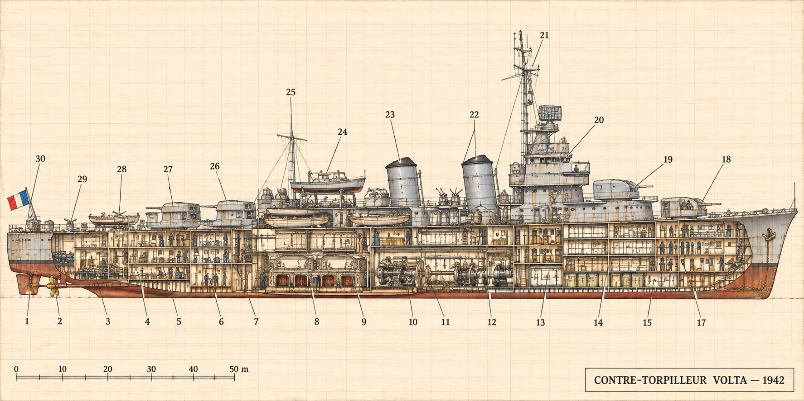
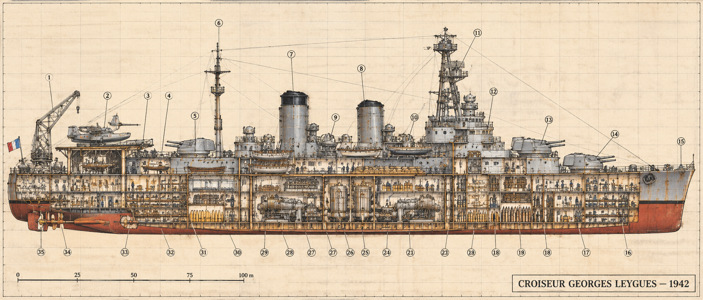
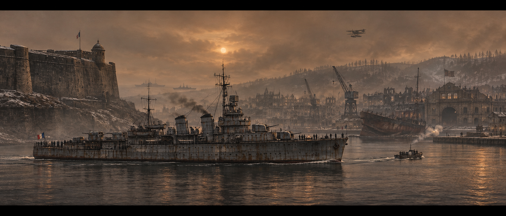

# 36 — L'expédition de la Manche (été 1942)

> La seule grande sortie de l'îlot vers l'Atlantique avant l'épidémie et la fermeture de l'île : trois navires à mazout et un hydravion vont voir, au plus près de la catastrophe, ce qu'il reste de la Bretagne, de la Manche et des bases anglaises.
>
> **[canon]** (décisions de l'auteur) : une **expédition organisée en urgence** avant l'épidémie et la fermeture de 1944, à l'**été 1942** (option B) ; **déclenchée par un appel radio et par les familles de Brest** (option C) ; avec le HMS ***Faulknor***, le ***Volta*** et le ***Georges Leygues***, qui **embarque un Loire 130** sur quelques tonnes d'essence mises de côté (option C). L'expédition d'Albanie (1950) devient **la première sortie après l'épidémie**, non plus la première grande expédition de l'îlot. **[canon provisoire]** : le détail de ce chapitre ; ce qu'on trouve à terre reste en grande partie **à décider** (§6, §9).
>
> Ce chapitre précède le [35](35-navires-de-l-ilot.md) §6 : les limites de 1942 sont la raison du **navire de longue expédition**.

## 1. Le déclencheur [canon : option C ; provisoire : détail]

### 1.1 L'appel de Devonport (avril 1942)

**Le contexte radio** ([16](16-contacts-radio.md)) : en 1940-1941, les oxydes d'azote et la haute atmosphère chargée de vapeur d'eau brouillent les liaisons de jour. **En 1942, l'ionosphère redevient normale** : le jour se rouvre jusqu'à 2 500 km, et Plymouth est à environ 1 700 km de Cagliari.

**[canon provisoire]** Dans la nuit du 14 au 15 avril 1942, l'écoute du *Dunkerque* capte en Morse, faible et lent, l'indicatif de la **station radio de la Royal Navy de Devonport**. Le message est répété trois nuits de suite :
- il reste des survivants dans l'arsenal de Devonport et dans ses galeries ;
- ils n'ont plus de nouvelles du gouvernement, replié vers le nord ;
- ils demandent des nouvelles de la Force H et de Gibraltar, et **du grain**.

Cagliari répond. La quatrième nuit, Devonport accuse réception. **Puis plus rien** à partir du début de mai 1942 [à décider : panne, épuisement des batteries ou des hommes, B83].

### 1.2 Les familles de Brest

**[histoire 🔎] Brest était le port d'attache de la Force de Raid** : le *Dunkerque* et le *Strasbourg* y étaient basés avant de partir pour Mers el-Kébir au printemps 1940. Une partie des familles des officiers et des officiers mariniers de Gensoul est restée à Brest et dans sa région.

Depuis juillet 1940, les équipages français vivent sans nouvelles. **L'appel de Devonport prouve qu'on peut encore vivre à 470 km du cratère.** Brest est à la même distance ([02](02-impact-rambouillet.md)). Dans les bords français, la pression monte : il faut y aller **cette année**, tant qu'il y a du mazout.

## 2. La décision du Conseil (mai 1942) [canon provisoire]

| Membre | Position | Ses raisons |
|---|---|---|
| **Gensoul** | Pour | Les familles de Brest ; la continuité française ; ne pas laisser les équipages croire que le Conseil les abandonne |
| **Somerville** | Pour | Devonport a appelé la Force H par son nom ; Plymouth et Portsmouth sont des bases de la Royal Navy ; c'est un devoir |
| **Sportiello** | Réservé, puis pour | Le mazout ; le risque de perdre le *Georges Leygues* ; la pénurie de grain à Cagliari. Il obtient que l'expédition ne ramène **personne sans quarantaine** et **pas plus que ce que les navires peuvent porter** |

**Le coût** [estimation 🔧] :
- **Le mazout** : Cagliari – Gibraltar – Lorient – Brest – Plymouth – Portsmouth – baie de Seine – retour, environ **4 500 milles** à 14-15 nœuds. Il faut environ **1 200 t** pour le *Georges Leygues* et **400 à 500 t** pour chaque contre-torpilleur, soit **~2 200 t en tout**, en complétant les soutes à Gibraltar. C'est environ **3 % du stock** de 1942 ([15](15-energie.md) §3), au milieu de la campagne des dépôts.
- **Le grain** : **50 t** de blé et de farine pour Devonport et pour les familles de Brest, sur la réserve de Joseph ([28](28-bretagne.md)).

**Le vote** : le 9 mai 1942, à l'unanimité, après deux séances.

## 3. Les navires et l'hydravion [canon : option C ; provisoire : détail]

| Navire | Rôle | Pourquoi lui |
|---|---|---|
| ***Georges Leygues***, croiseur léger | **Navire-base** (le chef de l'expédition garde sa marque sur le *Faulknor*, §3.3) ; porte l'hydravion, le grain, l'équipe d'observation et le poste de soins ; peut loger 200 à 300 passagers en surcharge | Le croiseur le plus sûr de la force mobile ([12](12-flottes-survivantes.md) §3.3). Les croiseurs de sa classe étaient équipés pour **porter, catapulter et reprendre à la grue des hydravions** [histoire 🔎] |
| HMS ***Faulknor***, conducteur de flottille | Éclaireur ; **britannique**, pour les bases anglaises | Le pavillon que Devonport reconnaîtra ([12](12-flottes-survivantes.md) §2) |
| ***Volta***, contre-torpilleur | Éclaireur rapide ; **français**, pour Brest et Lorient | Le navire le plus rapide de l'îlot (près de 40 nœuds), qui peut se dégager de tout ([12](12-flottes-survivantes.md) §3.1) |

*Plan de coupe du* Volta *(classe* Mogador*) à l'été 1942, dans le style des plans d'ensemble des arsenaux. L'arrière est à gauche, l'avant à droite.*

**Légende** (d'après l'image) :

| N° | Arrière et coque | N° | Machines et avant | N° | Superstructures et armes |
|---|---|---|---|---|---|
| 1 | Gouvernail | 8 – 9 | **Chaufferies** : chaudières à tubes d'eau chauffées au mazout | 18 – 19 | Tourelles doubles de 138,6 mm avant, superposées |
| 2 | Hélices et arbres d'hélice | 10 – 11 | **Salles des machines** : turbines à engrenages, réducteurs, condenseurs | 20 | Passerelle et télémètre |
| 3 | Appareil à gouverner | 12 | Turbo-dynamos et auxiliaires | 21 | Mât de misaine |
| 4 – 5 | Postes de l'équipage et logements arrière | 13 | Poste central et transmissions | 22 – 23 | Cheminées avant et arrière |
| 6 | Soutes à munitions arrière | 14 – 15 | Soutes à munitions avant, sous les tourelles | 24 | Vedette à moteur, pour les débarquements |
| 7 | Ateliers et magasins | 17 | Postes de l'équipage avant, puits aux chaînes | 25 | Mât arrière |
| | | | | 26 – 27 | Tourelles doubles de 138,6 mm arrière |
| | | | | 28 | Embarcation sur bossoirs |
| | | | | 29 | Grenadeurs et mitrailleuses de la plage arrière |
| | | | | 30 | Pavillon national |

**Écarts de l'image au canon et à l'histoire** :
- **Les tubes lance-torpilles** : l'image montre une rangée de tubes entre les cheminées, mais sous le pont. Dans le navire réel, deux affûts triples et deux doubles sont **sur le pont**, dans l'axe [histoire].
- **Les chaufferies et les cheminées ne sont pas alignées** : dans le navire réel, les conduits de fumée montent des chaudières aux cheminées. Ici, les conduits coudés plongent vers les salles des machines (10-11), et les chaudières (8-9) restent sous l'arrière 🔎.
- **Le n° 16 manque** dans la numérotation.
- **Les embarcations supplémentaires** et la peinture rouillée sont voulues : ce sont les traces de deux ans sans carénage et les préparatifs de l'expédition.

*Plan de coupe du* Georges Leygues *(classe* La Galissonnière*) à l'été 1942, navire-base de l'expédition de la Manche, dans le même style que celui du* Volta. *L'arrière est à gauche, l'avant à droite. Sur l'arrière, le Loire 130 de Tom Penhallow et sa grue ; sur le pont, au milieu, les sacs de grain.*

**Légende** (d'après l'image) :

| N° | Arrière et aviation | N° | Superstructures et armes | N° | Coque, machines et soutes |
|---|---|---|---|---|---|
| 1 | **Grue de l'hydravion**, sur la plage arrière | 7 – 8 | Cheminées arrière et avant | 16 – 17 | Puits aux chaînes, postes de l'équipage avant |
| 2 | **Le Loire 130**, sur le toit du hangar | 9 – 10 | Affûts doubles de 90 mm contre avions, entre les cheminées | 18 – 19 | Soutes à munitions et magasins avant, sous les tourelles (numéros en double sur l'image) |
| 3 | Plateforme de l'hydravion et **hangar** (ateliers d'aviation) | 11 | Mât de misaine et direction de tir | 21, 23 | Poste central et transmissions, sous la passerelle |
| 4 | Pont arrière, embarcations | 12 | Passerelle | 24 – 27 | **Chaufferies** : chaudières à tubes d'eau au mazout, auxiliaires |
| 5 | Tourelle arrière | 13 – 14 | Tourelles avant, superposées | 28 | **Salles des machines** : turbines à engrenages, réducteurs |
| 6 | Grand mât | 15 | Étrave et ancre | 29 – 30 | Soutes à mazout du double fond, arbres d'hélice |
| | | | | 31 | Soute à munitions arrière |
| | | | | 32 | Logements des officiers, infirmerie |
| | | | | 33 – 35 | Presse-étoupe, hélices, gouvernail |

**Écarts de l'image au canon et à l'histoire** :
- **Les tourelles sont doubles** : l'image montre trois tourelles de **deux** canons. Le navire réel porte **neuf canons de 152 mm en trois tourelles triples** [histoire].
- **L'hydravion** est posé sur le toit du hangar, sans catapulte visible. Dans le navire réel, la **catapulte est sur le toit de la tourelle arrière** et la grue reprend l'appareil à la mer [histoire 🔎 : place exacte du hangar]. Les ailes sont déployées, et non repliées. L'appareil est bien un **hydravion à coque**, moteur au-dessus de l'aile.
- **Le mât de misaine** est une tour en treillis ; le navire réel a une **tour de passerelle et un mât tripode** [histoire 🔎].
- **Les cheminées** sont droites et massives, et non inclinées.
- **L'échelle est fausse** : la règle de 100 m donne un navire d'environ 300 m, alors qu'il mesure **179 m** [histoire].
- **Les chaufferies** : on ne voit que deux chaudières, au lieu de quatre ; les **tubes lance-torpilles** (deux affûts triples) manquent ; les affûts de 90 mm sont fermés, alors qu'ils étaient ouverts.
- **La numérotation** : 18, 19 et 27 sont en double, 20 et 22 manquent.
- **Conformes au canon** : les **sacs de grain** sur le pont, les embarcations supplémentaires, la peinture rouillée, la grue arrière, le pavillon national, la ceinture cuirassée à la flottaison.

### 3.1 L'essence de l'hydravion

Le canon dit que **l'essence est épuisée fin 1941** et que les avions sont cloués au sol dès l'hiver 1940-1941 ([15](15-energie.md) §2). **[canon provisoire] La réserve d'essence du Conseil** : pendant l'hiver 1940-1941, sur la demande des aviateurs, le Conseil fait mettre sous scellés **6 t d'essence aviation** en fûts, dans une galerie de mine, « pour une reconnaissance que la flotte ne pourra pas faire ». Elle n'est ouverte qu'une fois, pour l'expédition de la Manche.

### 3.2 Le Loire 130 et son pilote

- **L'appareil** : un **Loire 130** de la section du *Strasbourg* ([20](20-capacites-aeronavales.md)), révisé à Elmas en mai et juin 1942 et embarqué sur le *Georges Leygues*. Il décolle par catapulte et se pose sur la mer ; la grue le reprend à bord. Rayon d'action : environ 1 000 km [histoire 🔎].
- **Le pilote** (décision de l'auteur) : le lieutenant **Tom Penhallow**, de la Fleet Air Arm, ancien pilote de Swordfish de l'*Ark Royal* [personnage inventé, **l'un des protagonistes du futur roman**] (biographie en [20](20-capacites-aeronavales.md) §4.5). **Il est né à Plymouth en 1918.** Avant l'*Ark Royal*, il a volé sur hydravions dans une escadrille de catapulte ; à l'automne 1940, il a appris le Loire 130 à Elmas avec la section du *Strasbourg*.
- **La mission de l'hydravion** (décision de l'auteur) : **le renseignement**. D'abord **l'origine de la catastrophe** : trouver et décrire le point d'impact, que personne à Cagliari n'a vu (le vol du cratère, §6.4). Ensuite **le compte rendu de l'état des villes** : Lorient, Brest, Plymouth, Portsmouth, Le Havre, Rouen, Paris ; photographies, croquis, épaisseur des éjectas, ports utilisables, traces de vie. C'est la matière du **Rapport de la Manche**. Les recherches personnelles passent après la mission.
- **Pourquoi un Anglais** (décision de l'auteur) : les Britanniques de Cagliari tiennent à ce que **des marins et des aviateurs anglais** prennent part à l'expédition, qui va chercher les leurs à Plymouth. Le *Faulknor* porte les marins ; l'hydravion, français, a un pilote anglais. [canon provisoire] L'observateur et le radio du Loire 130 sont français, de l'ancienne section du *Strasbourg*.
- **Le carburant** : un vol de trois heures brûle environ 400 kg d'essence. Les 6 t permettent **une douzaine d'heures de vol** sur l'ensemble de l'expédition, avec une marge pour l'évaporation et les essais [estimation 🔧].

### 3.3 Les hommes

Environ **1 000 hommes** en tout : les équipages réduits des trois navires ; une **équipe d'observation** (un médecin, un géologue des mines, un météorologue, un photographe, deux interprètes allemands) ; une section de **fusiliers marins** pour les débarquements ; un **poste de soins**.

**Le chef de l'expédition** (décision de l'auteur : un Britannique, officier réel de 1940) : le **captain Antony Fane de Salis**, Royal Navy, commandant du HMS *Faulknor* et *Captain (D)* de la 8ᵉ flottille de destroyers de la Force H depuis février 1940 [histoire]. Dans notre histoire, il commande le *Faulknor* à Mers el-Kébir en juillet 1940.
- **Pourquoi lui** [canon provisoire] : Devonport a appelé la Force H ; c'est à un officier britannique d'entrer à Plymouth et à Portsmouth. Somerville le propose, Gensoul l'accepte à condition que **Brest et Lorient soient l'affaire des Français**.
- **Sa marque** : il la garde sur **son propre navire**, le *Faulknor*, en tête de la force. Le *Georges Leygues* garde son commandant ; c'est le navire-base de l'expédition (hydravion, grain, soins, passagers).

**Le *Volta* et Brest** [histoire] : avant la guerre, le *Volta* et le *Mogador* formaient la 6ᵉ division de contre-torpilleurs de la **Force de Raid, basée à Brest**. Son équipage compte beaucoup de Brestois.

**Le commandant du *Volta*** : un capitaine de frégate, chef prudent, qui répond de son navire devant le Conseil [personnage inventé ; à remplacer si le nom réel de 1940 est retrouvé 🔎]. Il ne quitte pas son bord.

**Le protagoniste : un jeune officier du *Volta*** (décision de l'auteur) : un **personnage inventé**, **l'un des protagonistes du futur roman** : **enseigne de vaisseau** en 1942 (décision de l'auteur), de 22 à 25 ans : **Jean de Kerangal** (décision de l'auteur, B88).
- **Pourquoi un jeune officier** (décision de l'auteur) : un commandant ne quitte jamais son navire ; il en a la responsabilité. Un officier subalterne, lui, peut mener une petite troupe à terre, loin de la rade.
- **Son profil** (option C) : **Brestois**. Sa famille vivait à Brest en 1940. **Elle a quitté la ville en juin 1940**, à l'arrivée des Allemands, pour la campagne, chez des parents [lieu à décider : la presqu'île de Crozon, le Léon ou les monts d'Arrée ; qui : parents, frères et sœurs, peut-être une fiancée, à décider].
- **Ce que cela change** : pour les retrouver, il doit aller **à l'intérieur des terres**, à 30 ou 60 km de la rade, contre le calendrier de trois semaines et contre la prudence de de Salis. Il lui faut l'accord de son commandant, puis celui du chef de l'expédition.
- **Après 1942** (décision de l'auteur) : il devient **le commandant du prototype de longue expédition**. Détaché au Bureau des plans dès 1946 comme témoin de la Manche, officier d'armement pendant la transformation (1947-1949), second pendant les essais, il prend le commandement en 1952 et retourne en Bretagne dix ans après ([35](35-navires-de-l-ilot.md) §6.3 bis).

## 4. La route et le calendrier [canon provisoire]

| Date | Étape | Ce qu'on fait |
|---|---|---|
| **20 juin 1942** | Départ de Cagliari | |
| **23 – 25 juin** | **Gibraltar** | On complète les soutes au dépôt du Rocher ([07](07-le-monde-apres.md) §2 bis) ; la garnison donne ses cartes des champs de mines de 1939-1940 |
| **29 – 30 juin** | **Lorient** | Reconnaissance par la mer et par l'hydravion (§6) |
| **1er – 7 juillet** | **Brest** | Entrée dans le goulet le **2 juillet 1942**, deuxième anniversaire de la catastrophe. Débarquement, recherche des familles (§6) |
| **9 – 12 juillet** | **Plymouth** (Devonport) | Le *Faulknor* entre le premier (§6). **Le *Volta* reste à Brest** (§6.2) |
| **13 – 14 juillet** | **Portsmouth** et le Solent | Reconnaissance par la mer |
| **15 – 18 juillet** | **Baie de Seine** | Mouillage devant Le Havre ; **vol vers le cratère** (§6.4) |
| **19 – 21 juillet** | Retour par Brest | On reprend ceux qui partent (§6.2) |
| **27 juillet** | Gibraltar | Soutes |
| **31 juillet 1942** | **Retour à Cagliari** | Quarantaine de précaution au lazaret (§7) |

**Six semaines**, dont environ trois sur les côtes de la Manche.

*Carte : atlas de l'Îlot, planche « Manche 1942 » (cartes/index.html#manche).*

## 5. Les conditions de l'été 1942 [estimation]

*D'après le chapitre [04](04-climat.md).*

| Élément | État |
|---|---|
| **La lumière** | 20 à 50 % de la normale : un **crépuscule brun** à midi ; les photographies demandent de longues poses |
| **La température** | En Bretagne, quelques degrés au-dessus de zéro le jour, **du gel la nuit**, même en juillet ; la neige tient sur les monts d'Arrée. La mer est froide, mais libre |
| **La glace** | La banquise de l'hiver est descendue jusqu'à la mer du Nord ; en juillet, des **glaces flottantes** peuvent dériver jusqu'au pas de Calais 🔧. L'expédition ne va pas à l'est de la baie de Seine |
| **Le temps** | Brouillards fréquents ; coups de vent d'ouest. L'hydravion ne vole que deux jours sur trois |
| **Les mines** | Champs de mines britanniques et allemands de 1939-1940 devant les ports et dans la Manche 🔎. On suit les routes des cartes de Gibraltar, avec un contre-torpilleur en tête |
| **Les terres** | Forêts mortes ou brûlées, champs gelés, villes incendiées ; **aucune fumée de cheminée** sur des dizaines de kilomètres, sauf autour de quelques points habités |

## 6. Ce qu'on trouve [canon : options B84, B85, B83 ; provisoire : détail]

### 6.1 Lorient (29-30 juin)

*Le 29 juin 1942, le* Volta *entre dans la rade de Lorient sous la citadelle de Port-Louis. Au large, le* Georges Leygues *et le* Faulknor *attendent dans la brume ; au-dessus, l'hydravion de Penhallow. Sur les quais, la fumée blanche du coup de semonce qui accueille l'embarcation du* Volta.

**Écarts de l'image au canon et à l'histoire** :
- **Le pavillon délavé de l'arsenal** (§6.1) n'apparaît pas.
- **Trop de fenêtres éclairées** dans la ville : sans électricité, la communauté de Lorient n'a que quelques feux.
- **Des collines trop hautes** : les rives de la rade de Lorient sont basses.
- **La citadelle de Port-Louis** est sur la rive est de la passe [histoire] ; la vue est donc prise depuis Larmor ou Gâvres, en regardant vers l'est (le prompt la plaçait simplement « à gauche »).
- Le ciel brun, le froid, les forêts mortes, l'épave près de l'arsenal, les grues et l'absence de base de sous-marins sont conformes au canon ([04](04-climat.md), §5).
- **En 1940** [histoire] : la Kriegsmarine occupe le port depuis le 21 juin 1940 et y prépare une base de sous-marins.
- **Ce qu'on trouve** (option B) : **une communauté mixte**. La ville est brûlée, mais autour de l'arsenal et de Kéroman vivent quelques centaines de personnes : des **marins de la Kriegsmarine** restés après l'automne 1940 et des **Lorientais**, ouvriers de l'arsenal, pêcheurs et familles. Ils sont menés par le vice-amiral **Lothar von Arnauld de la Perière** [histoire : né en 1886, l'as des sous-marins de 1914-1918, descendant de huguenots français ; commandant de la Marine allemande en Bretagne à l'été 1940, basé à Brest 🔎]. [canon provisoire] À l'automne 1940, quand la garnison de Brest part vers l'est, il refuse de la suivre, se replie sur Lorient avec les marins qui veulent rester, et tient la base avec les Lorientais. Il parle français. *Dans notre histoire, il meurt en février 1941 dans un accident d'avion au Bourget 🔎 ; dans l'uchronie, il ne quitte plus la Bretagne.* Deux ans de faim commune ont effacé l'occupation ; on parle un mélange de français, de breton et d'allemand.
- **La rencontre** : un coup de fusil de semonce accueille l'embarcation du *Volta*. Puis on parlemente, par les interprètes, à la cale de l'arsenal. **Brest et Lorient sont l'affaire des Français** : c'est le commandant du *Volta* qui mène la parlementation, avec le jeune officier (§3.3) comme interprète de breton.
- **Le troc, sans débarquer** : du grain et des médicaments contre **les cartes allemandes des champs de mines** de la Manche et de l'Iroise, et contre des nouvelles : en septembre 1940, une colonne de la garnison a tenté de rejoindre l'Allemagne par la route ; quelques hommes sont revenus, et ils racontent un pays brûlé et gelé jusqu'à la Loire.
- **La suite** [canon provisoire] : Lorient demande qu'on revienne. On le promet, sans date.

### 6.2 Brest (1er-21 juillet)

- **En 1940** [histoire] : les Allemands entrent dans Brest le 19 juin 1940. La flotte et l'École navale sont parties.
- **La ville** : à la limite de la zone des toitures arrachées ([02](02-impact-rambouillet.md)). Elle a brûlé en partie pendant la nuit de feu, mais **l'arsenal de la Penfeld et le château tiennent debout**. C'est le port le mieux conservé de la côte.
- **Ce qu'on trouve** (option B) : **un vrai îlot breton**, de **1 500 à 2 000 personnes**, autour de l'arsenal, du château et des fermes du Léon : ouvriers de l'arsenal, marins et réservistes restés à terre, familles, paysans. Ils sont menés par un **ingénieur du Génie maritime** de l'arsenal [personnage inventé, à nommer]. **La garnison allemande** est partie vers l'est à l'automne 1940 ; quelques soldats sont restés et se sont fondus dans le pays. L'îlot a les cinq conditions de [07](07-le-monde-apres.md) §1 bis : une institution (l'arsenal), du bois et de la tourbe, la mer, des livres et une défense.
- **Ils refusent de partir.** Brest est leur pays, et ils tiennent. Ils demandent du grain, des médicaments, des semences, et **un rendez-vous radio** : on leur laisse des heures de vacation et des lampes d'émission.
- **Les familles** : on affiche à l'arsenal les listes des équipages de Gensoul. Les familles des marins de la Force de Raid qu'on retrouve à Brest et dans les environs peuvent partir. **Environ 150 personnes** embarquent au retour, le 19 juillet, presque toutes des **femmes et des enfants** [canon provisoire].
- **Le jeune officier du *Volta***, Jean de Kerangal (§3.3), demande à partir à terre. Son commandant appuie la demande, et de Salis accepte que **le *Volta* reste à Brest** pendant que le *Faulknor* et le *Georges Leygues* vont à Plymouth et en baie de Seine (9-18 juillet), **avec un ordre écrit** : être de retour à bord le 18 juillet au soir. L'officier part à terre, avec quelques marins et un guide de l'îlot breton, chercher sa famille à l'intérieur. **Ce qu'il trouve, et s'il revient à l'heure, est laissé au roman.**
- **Après 1942** [canon provisoire] : les vacations avec Brest tiennent jusqu'à la fermeture de l'île, puis se perdent dans le silence de 1944-1946 ([16](16-contacts-radio.md) §5). **Brest est la destination naturelle du navire de longue expédition** des années 1950 ([35](35-navires-de-l-ilot.md) §6).

### 6.3 Plymouth (9-12 juillet)

- **L'arsenal de Devonport** : endommagé, mais debout (il est à 470 km du cratère, comme Brest).
- **Le vol au-dessus de Plymouth** (décision de l'auteur) : avant l'entrée du *Faulknor*, Penhallow reconnaît Plymouth, le Sound et Devonport pour le Rapport de la Manche : état de la ville, mouillages, traces de vie. C'est **sa ville natale** : en passant, il regarde aussi les quartiers où vivait sa famille, pendant que Kerangal cherche la sienne à pied en Bretagne. **Ce qu'il voit est laissé au roman.**
- **Ce qu'on trouve** (option B) : **personne**. La station radio est vide, l'émetteur démonté et emporté. Un message est cloué au mur, en anglais et en signaux : les survivants (quelques centaines) ont attendu la réponse de Cagliari ; elle disait « nous viendrons cet été ». Ils n'avaient plus de quoi attendre. **Début mai 1942, ils sont partis vers le nord, par la mer, pour le pays de Galles** (Milford Haven, les mines de charbon) [canon provisoire : destination], en laissant la date, leur nombre et l'indicatif qu'ils utiliseront.
- **De Salis ne les suit pas** : le mazout, le calendrier, et le *Volta* resté à Brest. Il laisse à son tour un message et du grain dans la station.
- **La piste** : le pays de Galles et, au-delà, la Clyde et Scapa Flow ([07](07-le-monde-apres.md) §1) deviennent l'objectif d'un voyage futur ([35](35-navires-de-l-ilot.md) §6, B77). L'indicatif laissé à Devonport est écouté chaque nuit à Cagliari [à décider : l'entend-on ?].

### 6.4 Portsmouth, la baie de Seine et le vol vers le cratère (13-18 juillet)

- **Portsmouth** : l'arsenal est ravagé ([02](02-impact-rambouillet.md) §3) ; on l'observe de la mer, sans débarquer.
- **Le Havre** : ville détruite, à environ 155 km du cratère ; des dizaines de centimètres d'éjectas gris sur les quais.
- **Le vol du 17 juillet 1942** [canon provisoire] : Penhallow remonte la Seine, passe sur Rouen (environ 60 cm d'éjectas), puis sur **Paris**, qu'il ne trouve qu'à la boucle du fleuve : la ville est **ensevelie sous environ 5 m de débris**, et seuls émergent les plus hauts monuments. Plus au sud-ouest, il voit le **rempart du cratère** dans la brume : un anneau de 25 km de diamètre, d'Épernon à Saint-Arnoult ([02](02-impact-rambouillet.md) §1). **Aucune vie visible.** Le vol dure 3 h 20. Les photographies de cette journée sont les seules images du cratère prises avant les années 1950.

### 6.5 Les savants, les plans et les livres [canon : option B89 A + B ; provisoire : détail]

**Décision de l'auteur** : en 1942, l'expédition ramène **quelques savants et ingénieurs volontaires** de Bretagne (A) et **des livres et des plans** (B) ; l'Angleterre viendra dans les années 1950 ([35](35-navires-de-l-ilot.md) §6.5).

**La consigne** est celle de [19](19-savoir-et-medecine.md) §3.7 : chercher, parmi les survivants, les ingénieurs, les médecins et les savants, et leur offrir le passage en premier. Mais **Brest refuse de partir** (§6.2) : on ne prend pas, on **négocie**.

**Les hommes (A)** [canon provisoire] :

| Qui | D'où | Pourquoi ils partent | Ce qu'ils deviennent dans l'île |
|---|---|---|---|
| **Deux ingénieurs du Génie maritime** de l'arsenal de Brest [personnages inventés, à remplacer si les noms réels sont retrouvés 🔎] | L'arsenal de la Penfeld | **Prêtés** par l'îlot breton contre le grain, les semences et la promesse de revenir ; l'un d'eux a sa famille parmi celles de la Force de Raid | Le cœur du **Bureau des plans** de 1946 ([35](35-navires-de-l-ilot.md) §4.2) : la conception navale de l'îlot leur doit tout |
| **Georges Teissier** [histoire : biologiste de la Sorbonne (1900-1972), habitué de la station de Roscoff, qu'il dirigera de 1945 à 1971 ; canon provisoire : présent à Roscoff en juillet 1940 🔎] | La **station biologique de Roscoff**, à 60 km de Brest | La station n'a plus de quoi travailler ; à Cagliari, il y a une université, une flotte et du poisson à étudier | **Siège de biologie** au Conseil scientifique ([19](19-savoir-et-medecine.md) §3.2) : la mer, la pêche, les *paranze* ([35](35-navires-de-l-ilot.md) §2.3), la statistique des récoltes et des naissances |
| **Un biologiste du laboratoire de Concarneau** (Collège de France) [à nommer 🔎] | Concarneau, à 25 km de Lorient, recueilli par les gens de Lorient | Il demande à partir lors de la parlementation (§6.1) | La pêche et les étangs de l'île ([17](17-autosuffisance-alimentaire.md) §3) |

- **Ceux qui restent** : **Charles Pérez** [histoire : zoologiste, directeur de la station de Roscoff de 1921 à 1945], 69 ans en 1942, refuse de quitter sa station. Il garde la bibliothèque de Roscoff et en confie quelques ouvrages à Teissier.
- Ces savants et leurs familles, une quinzaine de personnes, sont compris dans les **environ 150 passagers** de Brest (§7).

**Les plans et les livres (B)** [canon provisoire] :
- **L'arsenal de Brest** prête, pour copie, les **plans des navires** construits ou refondus à Brest (dont ceux du *Dunkerque* et du *Richelieu*) et les **règlements techniques** de la Marine. Le Bureau des plans de 1946 en fera ses modèles.
- **Les livres de l'École navale**, restés à Brest après le départ de l'École en juin 1940 🔎 : cours de navigation, de machines, d'architecture navale. Ils fondent la bibliothèque de l'École navale de l'Îlot (1946, [13](13-societe-de-bord.md) §4 quater).
- **La bibliothèque du laboratoire de Plymouth** : l'un des grands laboratoires de biologie marine d'Europe, celui de la Marine Biological Association, sur Citadel Hill [histoire]. Le bâtiment est abandonné (§6.3). De Salis fait embarquer **les collections de revues et les ouvrages de pêche et d'océanographie**, environ 3 000 volumes, et laisse un reçu au nom du Conseil. C'est la première grande moisson du futur Conservatoire ([19](19-savoir-et-medecine.md) §5).
- **Le directeur du laboratoire de Plymouth**, **Stanley Kemp** [histoire : directeur de 1936 à sa mort], est parti avec le groupe de mai vers le pays de Galles [canon provisoire] : c'est une raison de plus d'aller les chercher. Il y meurt vers 1947 ([38](38-personnages-historiques.md) §6).

## 7. Le retour et la quarantaine (fin juillet 1942) [canon provisoire]

- **Pas encore de peste en Europe de l'Ouest** : la Morìa naît au Kurdistan à la fin de l'été 1942 ([14](14-epidemie.md)). Mais on craint le **typhus** des abris et les poux. Les **environ 150 passagers de Brest** font **trois semaines de quarantaine** et sont épouillés au lazaret de l'île de San Macario, devant Cagliari [lieu à vérifier 🔎]. Ils sont inscrits au rôle à la fin d'août 1942 ; environ 140 sont encore en vie en 1946 ([21](21-demographie.md) §6).
- **Le Rapport de la Manche** : l'équipe d'observation et le chef de l'expédition le remettent au Conseil en septembre 1942. Il décrit l'état des ports, des terres et des survivants, et il contient les photographies du cratère. C'est le **premier document de l'îlot sur l'Europe après la catastrophe** ; il sera recopié pour la bibliothèque ([19](19-savoir-et-medecine.md)).

## 8. Les leçons de 1942 : pourquoi un navire de longue expédition [canon provisoire]

1. **Le mazout** : 2 200 t pour six semaines. On ne peut pas recommencer souvent, et à partir de 1943-1944 plus du tout : la Morìa ferme l'île ([14](14-epidemie.md) §5.6) et le stock fond ([15](15-energie.md) §3).
2. **Le temps sur place** : trois semaines, c'est trop court. On n'a pas pu aller à terre loin des ports, ni attendre ceux qui arrivaient de l'intérieur.
3. **L'hydravion** : c'est lui qui a vu Lorient, l'intérieur de la Bretagne et le cratère. Mais son essence était la dernière.
4. **La mer** : des navires de guerre rapides sont des navires étroits, mouillés, qui portent peu. Il faut **un navire de charge**, sûr à la mer, qui tienne quatre mois.

D'où la commande du Conseil au **Bureau des plans** en 1946 : un **navire de longue expédition**, au charbon avec une voile d'appoint, qui porte son hydravion et sa grue, son infirmerie et sa radio à longue portée, avec un équipage réduit au minimum. **Le prototype est transformé à Cagliari pendant l'épidémie, sur un cargo désarmé de 1940, et armé en 1949** ([35](35-navires-de-l-ilot.md) §6.3 bis). **L'expédition de la Manche est le modèle, et l'échec partiel, dont il sort** ; et l'enseigne du *Volta* qui avait couru la Bretagne en 1942 en devient le commandant.

## 9. Questions ouvertes

1. ✅ **La date** : été 1942 (option B).
2. ✅ **Le déclencheur** : l'appel de Devonport et les familles de Brest (option C).
3. ✅ **Les navires** : *Faulknor*, *Volta* et *Georges Leygues* avec un Loire 130 (option C).
4. ✅ **L'Albanie (1950)** devient la première sortie après l'épidémie (décision de l'auteur).
5. ✅ **Le chef de l'expédition** : un Britannique, officier réel de 1940 (décision de l'auteur) : le captain **Antony Fane de Salis**, du *Faulknor* (§3.3).
5 bis. ✅ **Le protagoniste** : non pas le commandant, mais **un jeune officier du *Volta***, **enseigne de vaisseau**, personnage inventé, protagoniste du futur roman (décision de l'auteur : un commandant ne quitte pas son navire). Il devient en 1952 le **commandant du prototype de longue expédition** ([35](35-navires-de-l-ilot.md) §6.3 bis, décision de l'auteur). Son nom : **Jean de Kerangal** (B88, décision de l'auteur). Le commandant du *Volta* est un personnage inventé, à remplacer si le nom réel est retrouvé.
5 quater. ✅ **Le pilote du Loire 130** (décision de l'auteur) : **Tom Penhallow**, pilote d'hydravion britannique de l'*Ark Royal*, né à Plymouth, protagoniste du futur roman, au lieu de Kerlann, qui disparaît de la bible : les Britanniques de Cagliari tiennent à ce que des marins et des aviateurs anglais prennent part à l'expédition ; sa mission est le renseignement, l'origine de la catastrophe et l'état des villes (§3.2, §6.3, §6.4). ❓ Sa famille à Plymouth (B110).
5 ter. ✅ **Son profil** : Brestois, sa famille a quitté Brest en juin 1940 pour la campagne ; il la cherche à l'intérieur pendant que le *Volta* reste à Brest (option C). Ce qu'il trouve est laissé au roman.
6. ✅ **Devonport** : les survivants sont partis vers le pays de Galles début mai 1942, en laissant un message (option B). ❓ Leur nombre, leur chef, et l'îlot entend-il leur indicatif plus tard ?
7. ✅ **Lorient** : une communauté mixte de marins allemands et de Lorientais, menée par le vice-amiral **Lothar von Arnauld de la Perière** (B90, option A) ; parlementation et troc sans débarquer (option B).
8 bis. ✅ **Les savants** (B89) : en 1942, quelques volontaires bretons (deux ingénieurs du Génie maritime de Brest, Georges Teissier de Roscoff, un biologiste de Concarneau) et des livres et des plans (Brest, l'École navale, la bibliothèque du laboratoire de Plymouth) ; l'Angleterre dans les années 1950 (§6.5). ❓ Les noms des ingénieurs de Brest et du biologiste de Concarneau ; 🔎 la présence de Teissier à Roscoff en juillet 1940.
8. ✅ **Brest** : un vrai îlot breton de 1 500 à 2 000 personnes, mené par un ingénieur du Génie maritime ; il refuse de partir ; environ 150 personnes des familles des marins rejoignent l'île (option B ; modèle de démographie mis à jour). ❓ Le nom de l'ingénieur ; le lieu de refuge de la famille du commandant du *Volta*.
9. 🔎 **À documenter** : les familles de la Force de Raid à Brest en 1940 ; les hydravions des croiseurs de la classe *La Galissonnière* (catapulte, grue, nombre d'appareils) ; l'autonomie du Loire 130 ; les champs de mines de la Manche en 1939-1940 ; le lazaret de Cagliari en 1942.
10. 🔧 **À vérifier** : la consommation de mazout des trois navires ; la dérive des glaces dans la Manche à l'été 1942.
